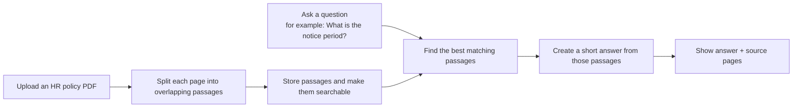

# HR Policy Finder

**Upload an HR-policy PDF, ask a question in plain English, and get an answer with the exact policy pages that support it.**

For example, a person can upload an employee handbook and ask, “How much annual leave do I get?” Instead of reading the whole document, the app finds the most relevant passages, produces a short answer, and lets the person check the original wording and page number.

## What this repository provides

- A simple web page for uploading a text-based HR-policy PDF and asking questions.
- A search pipeline that finds relevant policy passages using both meaning and keywords.
- A short Gemini-generated answer grounded in those passages.
- Supporting passages, document names, and page numbers so answers can be verified.
- Supabase PostgreSQL with pgvector for persistent documents and semantic search.

It is designed for **policy lookup**, not legal advice or a replacement for HR review.

## How it works



The app does not search the open internet. It answers from the PDF documents that have been uploaded to it.

## What happens after a question is asked

1. The app looks for passages with similar meaning to the question.
2. It also looks for exact words and phrases, such as “notice period” or “gratuity.”
3. It combines both results, ranks the strongest passages, and selects the best five.
4. Gemini receives only those passages and writes a short answer.
5. Gemini returns the IDs of the passages it used. The app validates those IDs and shows every cited document and page. Missing or invalid citations produce an error instead of a guessed source. An unanswered question has no citations.

PDFs are split with LangChain's `RecursiveCharacterTextSplitter`: **500 characters per chunk**, with **100 characters of target overlap**. Paragraph and line breaks are retained, and each page is split separately. These are starting settings, not a benchmarked optimum. The embedding model remains `sentence-transformers/multi-qa-MiniLM-L6-cos-v1` (384 dimensions); it tokenizes the resulting chunks internally. Embedding and reranking run on CPU. BM25 stays in memory; all vector storage and search use Supabase.

Source IDs make answers traceable to retrieved passages; they do not independently verify the model's claims.

## Run locally

You need Python 3.9–3.12, a Gemini API key, and a Supabase project with pgvector 0.8 or newer.

```sh
python3 -m venv .venv
source .venv/bin/activate
pip install -r requirements.txt
```

Create a server-only `.env` file in the project folder:

```text
GEMINI_API_KEY=your-gemini-api-key
SUPABASE_URL=https://your-project.supabase.co
SUPABASE_SERVICE_ROLE_KEY=your-service-role-key
```

`GEMINI_API_KEY` is required to generate answers. Supabase is required; missing configuration or an unavailable database produces a clear error. Keep the service-role key on the server.

Run [supabase.sql](supabase.sql) in the Supabase SQL editor, including when upgrading an existing installation, then start the app:

```sh
uvicorn app:app --host 127.0.0.1 --port 8765
```

Visit <http://127.0.0.1:8765>, upload a PDF, and ask a question. `data/hr_policy.pdf` is a fictional sample document for testing. Re-upload existing PDFs to replace their old token-based chunks with character-based chunks; restarting alone does not reprocess them. Use one application process so its in-memory BM25 corpus stays consistent with uploads.

The retrieval models download on first startup. Afterward, set `HF_HUB_OFFLINE=1` to stop model-update checks.

## HNSW search

`policy_chunks_embedding_idx` indexes the 384-dimensional embeddings with HNSW and cosine distance. `match_policy_chunks` orders directly by the distance operator with a limit. Its function-scoped settings prefer an index scan (`enable_seqscan=off`), set `hnsw.ef_search=100` for the API's maximum of 100 candidates, and enable `hnsw.iterative_scan=strict_order` to continue searching when dead tuples reduce the initial candidate set. These settings are restored when the function returns. HNSW is approximate: improved search speed can trade off against recall, and small tables may be faster with an exact scan.

An observed check on **2026-10-18**, before the function-scoped settings were added, showed a sequential scan of 100 chunks followed by a top-N sort, even though the HNSW index existed. Index existence alone does not prove index usage. To check the underlying search SQL with the function's settings:

```sql
begin;
set local enable_seqscan = off;
set local hnsw.ef_search = 100;
set local hnsw.iterative_scan = strict_order;
explain (analyze, buffers, verbose)
select chunk_id, 1 - (embedding <=> (select embedding from policy_chunks limit 1)) as similarity
from policy_chunks
order by embedding <=> (select embedding from policy_chunks limit 1)
limit 20;
rollback;
```

Look for `Index Scan using policy_chunks_embedding_idx` on the outer search. The sample-vector subquery may scan a row to obtain its input. This checks the underlying SQL, not an application's full request. A follow-up on **2026-10-21** confirmed an HNSW index scan with the new settings; the live RPC returned 20 results for a limit of 20 and all 99 stored chunks for a limit of 100. Recheck representative plans and retrieval quality as the corpus grows.

## Test and evaluate

```sh
HF_HUB_OFFLINE=1 python -m unittest -v
```

Tests use real local retrieval models and replace external service calls with test fixtures; they require no live Supabase or Gemini access.

For end-to-end retrieval evaluation, configure a **dedicated Supabase project**, apply `supabase.sql`, and upload only the PDFs named in `data/evaluation.json` with the selected chunk settings. The evaluator checks that the stored corpus matches, queries Supabase without writing documents, and includes its network time in retrieval latency:

```sh
HF_HUB_OFFLINE=1 python evaluate.py --repeats 3
```

Benchmark output is written locally under `data/` and is not committed. Page-level relevance scores measure retrieval; they do not prove answer correctness or that every condition and exception was included.

## Project layout

```text
app.py                 Web API and page routes
ingest.py              PDF reading and page-aware chunking
retrieval.py           Search, reranking, and Gemini answer generation
storage.py             Supabase storage and vector-search client
evaluate.py            Supabase retrieval evaluation script
test_system.py         Application tests
supabase.sql           Supabase database schema
templates/             Web page
static/                Web page styling
data/                  Fictional test PDF and evaluation data
```
