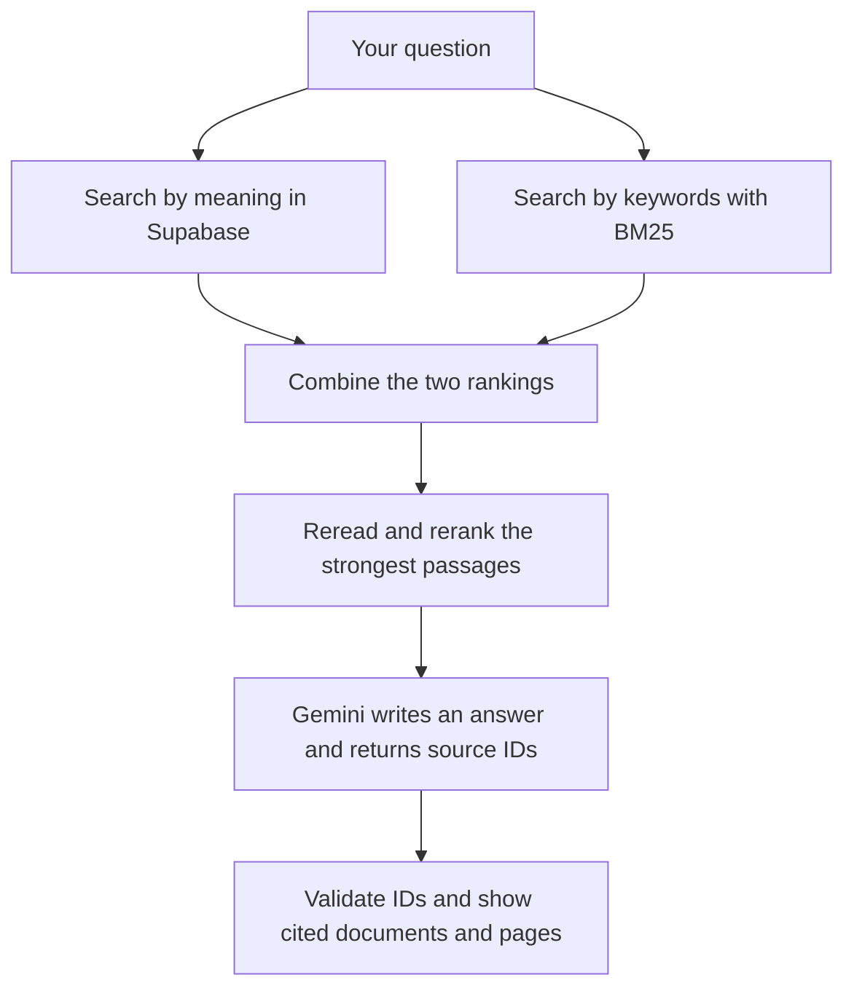

# HR Policy Finder

Upload an HR-policy PDF, ask a question, and get a short answer with the document names and page numbers cited by the model.

For example, upload an employee handbook and ask **“How many annual leave days do I get?”** The app finds relevant passages, asks Gemini to write an answer from them, and shows the passages so you can check the wording yourself.

This is a small **retrieval-augmented generation (RAG)** app: it finds document passages before generating an answer. It searches uploaded PDFs, not the internet.

[Folder guide](#folder-guide) · [How it works](#how-it-works) · [Run locally](#run-locally) · [Tests](#tests-and-evaluation) · [Common problems](#common-problems)

## Folder guide

Most of the application lives in **four Python files**. There is no frontend build step.

```text
rag-system/
├── app.py                  Receives uploads and questions; connects the other files
├── ingest.py               Reads PDFs and splits each page into smaller passages
├── retrieval.py            Finds passages, ranks them, and asks Gemini for an answer
├── storage.py              Saves PDFs and passages in Supabase; runs vector searches
│
├── templates/
│   └── index.html          The web page and its browser-side JavaScript
├── static/
│   └── style.css           Colors, spacing, typography, and mobile layout
│
├── data/
│   ├── hr_policy.pdf       Fictional policy document for trying the app
│   └── evaluation.json     Test questions and the pages expected to answer them
│
├── test_system.py          Automated tests for ingestion, search, citations, and API behavior
├── evaluate.py             Compares search methods using the evaluation questions
├── supabase.sql            Creates the database tables, storage bucket, and search functions
├── requirements.txt        Python packages needed to run the app
├── Dockerfile              Packages the app into a container with CPU inference
├── .dockerignore           Files left out of the Docker build context
├── .gitignore              Local files and secrets that Git should ignore
└── README.md               This guide
```

**If you are reading the code for the first time:**

1. Start with [`app.py`](app.py). Follow `/upload` and `/search` to see which functions each request calls.
2. Read [`ingest.py`](ingest.py) to understand how PDF pages become passages.
3. Read [`retrieval.py`](retrieval.py) to follow the search and answer pipeline.
4. Read [`storage.py`](storage.py) alongside [`supabase.sql`](supabase.sql) to see where data is saved and how vector matching works.
5. Open [`templates/index.html`](templates/index.html) to see how the browser sends requests and displays the responses.

## How it works

### When you upload a PDF

```text
Browser → app.py → ingest.py → embedding model → storage.py → Supabase
```

1. **Read the PDF.** The app checks the upload and extracts text from each page.
2. **Split the text.** LangChain's `RecursiveCharacterTextSplitter` creates passages of up to **500 characters**, with **100 characters of target overlap**. It keeps paragraph and line breaks where available and splits each page separately.
3. **Create embeddings.** A local model converts each passage into a vector of **384 numbers** representing learned features of its text. These are normalized so cosine similarity can compare them.
4. **Save the document.** Supabase Storage keeps the PDF. PostgreSQL keeps the passages, vectors, document names, and page numbers. The app also builds an in-memory keyword index.

Uploading the **same filename** replaces that document's stored passages. On startup, the app reloads saved passages from Supabase and rebuilds its keyword index.

### When you ask a question



- **Search by meaning:** the embedding model converts your question into a vector. Supabase finds nearby passage vectors using pgvector and an HNSW index.
- **Search by keywords:** BM25 looks for matching words, which helps with exact policy terms.
- **Combine:** Reciprocal Rank Fusion (RRF) rewards passages that rank well in either search.
- **Rerank:** a cross-encoder reads each shortlisted question–passage pair together and gives it a relevance score.
- **Answer and cite:** Gemini receives up to five passages and returns answer text plus their source IDs. The app checks those IDs and maps them to the stored document names and page numbers.

Missing or invalid citations cause an error; the app does not guess a source. If Gemini returns “I couldn't find this in the policy,” the answer has no citations. A valid citation identifies a supplied passage; it does not independently prove that the answer is correct.

### The main settings

| Setting | Current value |
|---|---|
| Passage size | Up to 500 **characters**, not tokens |
| Target overlap | 100 characters; actual overlap depends on text boundaries |
| Meaning-search candidates | Up to 20 |
| Keyword-search candidates | Up to 20 |
| Passages reranked | Up to 5 in the web page; the API default is 10 |
| Passages returned | Up to 5 by default |
| Embedding model | `sentence-transformers/multi-qa-MiniLM-L6-cos-v1` |
| Reranking model | `cross-encoder/ms-marco-MiniLM-L6-v2` |
| Answer model endpoint | `gemini-flash-lite-latest` |

The embedding and reranking models run on CPU. Gemini runs remotely and receives the question and retrieved passage text. The splitter settings are a starting configuration, not a benchmarked optimum.

## Run locally

You need **Python 3.9–3.12**, a **Supabase project with pgvector 0.8 or newer**, and a **Gemini API key**. Python 3.11 is used by the Docker image.

### 1. Download the project and install its packages

```sh
git clone https://github.com/siddhunangadi/rag-system.git
cd rag-system
python3 -m venv .venv
source .venv/bin/activate
pip install -r requirements.txt
```

If you already have the project, start from its folder and activate your virtual environment.

### 2. Set up Supabase

Open your Supabase project's **SQL Editor** and run the contents of [`supabase.sql`](supabase.sql). Run it when setting up a new project or upgrading an existing installation.

The script creates:

| Database object | What it holds or does |
|---|---|
| `policy_documents` | One record for each uploaded document |
| `policy_chunks` | Passage text, document/page metadata, and embeddings |
| `policy_chunks_embedding_idx` | HNSW index for finding similar vectors |
| `replace_policy_document` | Replaces a document's database records in one transaction |
| `match_policy_chunks` | Returns passage IDs and cosine similarity scores |
| `policy-pdfs` storage bucket | Original PDF files; the bucket is private |

### 3. Add your configuration

Create a file named `.env` beside `app.py`:

```text
SUPABASE_URL=https://your-project.supabase.co
SUPABASE_SERVICE_ROLE_KEY=your-service-role-key
GEMINI_API_KEY=your-gemini-api-key
```

Use the values from your Supabase project and Gemini account. Keep this file on the server; `.gitignore` excludes it from Git. Environment variables can also supply these settings and take precedence over `.env`.

Supabase is required for storage and semantic search. The Gemini key is needed when generating answers.

### 4. Start the app

```sh
uvicorn app:app --host 127.0.0.1 --port 8765
```

Open [http://127.0.0.1:8765](http://127.0.0.1:8765), upload `data/hr_policy.pdf`, and try an example question. **The sample PDF is fictional.**

The local models download on first startup, so the first run takes longer. Once they are cached, you can set `HF_HUB_OFFLINE=1` to skip Hugging Face network checks. Supabase and Gemini still need a network connection.

### Optional: run with Docker

After setting up Supabase and `.env`:

```sh
docker build -t hr-policy-finder .
docker run --rm --env-file .env -p 127.0.0.1:8765:8000 hr-policy-finder
```

The container serves the same app at [http://127.0.0.1:8765](http://127.0.0.1:8765). Models download on first container startup; their cache is not persisted by this command.

## API at a glance

| Method and path | Purpose | Input |
|---|---|---|
| `GET /` | Open the web page | None |
| `POST /upload` | Upload or replace a policy PDF | Multipart `file`; optional `chunk_size` and `overlap` in characters |
| `POST /search` | Find passages and generate an answer | JSON with `query`; optional search settings |
| `GET /metrics` | Inspect document/chunk counts and recent retrieval times | None |

For example, after uploading a document:

```sh
curl http://127.0.0.1:8765/search \
  -H 'Content-Type: application/json' \
  -d '{"query":"How many annual leave days do I get?"}'
```

The response includes `answer.text`, `answer.sources`, ranked `results`, and stage timings in `latency`. Each cited source includes its source ID, chunk ID, document name, and page number. If retrieval returns no passages, `answer` is `null`.

The search API supports `dense` (meaning), `bm25` (keywords), `rrf` (combined rankings), and `rerank` (combined rankings followed by reranking). Its default mode is `rerank`. The `/search` route also requests a Gemini answer in each mode.

## Tests and evaluation

**Tests check behavior.** Run them from the project folder:

```sh
python -m unittest -v
```

They use real local embedding and reranking models, with fixtures replacing external Supabase and Gemini calls. They cover PDF splitting, retrieval, policy conditions and exceptions, source validation, configuration errors, and API behavior. Cached models let you run them with `HF_HUB_OFFLINE=1`.

**Evaluation compares retrieval methods.** It uses [`data/evaluation.json`](data/evaluation.json), which contains questions and expected document pages. It reports how many relevant pages appear in the top five, how highly they rank, and how long retrieval takes.

Use a **dedicated Supabase project** for evaluation. Apply `supabase.sql`, point `.env` at that project, and upload only the PDFs named in the evaluation file using the selected chunk settings. The script refuses to run if the stored corpus does not match.

```sh
python evaluate.py --repeats 3
```

Results go to `data/benchmark.json`, which is excluded from Git. The evaluator reads Supabase without uploading documents or requesting Gemini answers. Retrieval timing includes query embedding and Supabase network calls; it excludes answer generation. Page-level scores do not establish that every policy condition was retrieved or that a generated answer would be correct.

## Common problems

| What you see | What to check |
|---|---|
| Missing Supabase configuration | Add `SUPABASE_URL` and `SUPABASE_SERVICE_ROLE_KEY` to `.env` or the environment. |
| Supabase cannot be reached, or tables/functions are missing | Check the project URL, service-role key, network connection, and that `supabase.sql` was applied. |
| “Upload a policy PDF first” | Upload a document; copying a PDF into `data/` does not index it automatically. |
| “No extractable text” | Use a text-based PDF. Scanned images need OCR, which is not included. |
| Models cannot load with offline mode enabled | Start once without `HF_HUB_OFFLINE=1` so the models can download. |
| Gemini is not configured or returns a service error | Check the Gemini key and service availability. |
| Missing or invalid source citations | The model response was rejected. Retry the question and inspect the retrieved passages. |
| Evaluation corpus mismatch | Use a separate project containing exactly the evaluation PDFs, uploaded with matching chunk settings. |

## Practical limits

- PDFs must be unencrypted and text-based, no larger than **20 MB**, with at most **300 pages** and **2 million extracted characters**. Uploads are limited to **5,000 total passages** across the app's document collection.
- Run **one application process**. Its keyword index stays in memory, and a lock keeps uploads and searches consistent within that process. Changes made through another app instance are not automatically synchronized.
- The app has a shared document collection, with no user login or per-user document separation.
- Re-upload PDFs after changing chunk settings. Restarting loads existing passages; it does not split saved PDFs again.
- Similarity and relevance scores are not confidence percentages. Retrieval has no minimum relevance threshold, so even an unrelated question may retrieve passages.
- Review the original wording for policy conditions and exceptions. This tool supports policy lookup; it does not replace HR review or provide legal advice.

<details>
<summary><strong>Technical note: checking HNSW index use</strong></summary>

HNSW is an approximate nearest-neighbor index: it trades some recall for search speed. An index existing does not prove that PostgreSQL uses it. On a small table, a full scan can be cheaper.

An observed check on **2026-10-18** showed a sequential scan of 100 chunks followed by a top-N sort despite the index existing. The current `match_policy_chunks` function orders directly by cosine distance and applies these settings for the duration of the function:

- `enable_seqscan=off` prefers an index scan.
- `hnsw.ef_search=100` increases the initial candidate search breadth.
- `hnsw.iterative_scan=strict_order` continues scanning when dead tuples reduce the initial result set.

The settings are restored when the function returns. A follow-up on **2026-10-21** confirmed an HNSW scan in the underlying query with these settings. The live RPC returned 20 results for a limit of 20 and all 99 stored chunks for a limit of 100. These small-corpus checks are not a general performance benchmark.

To inspect the underlying SQL on your own data:

```sql
begin;
select vector_dims('[0]'::vector);
set local enable_seqscan = off;
set local hnsw.ef_search = 100;
set local hnsw.iterative_scan = strict_order;
explain (analyze, buffers, verbose)
select chunk_id, 1 - (embedding <=> (select embedding from policy_chunks limit 1)) as similarity
from policy_chunks
order by embedding <=> (select embedding from policy_chunks limit 1)
limit 20;
rollback;
```

Look for `Index Scan using policy_chunks_embedding_idx` on the outer search. The sample-vector subquery may scan a row to obtain its input. This checks the underlying SQL, not an application's full request. Recheck representative plans and retrieval quality as the corpus grows.

</details>
